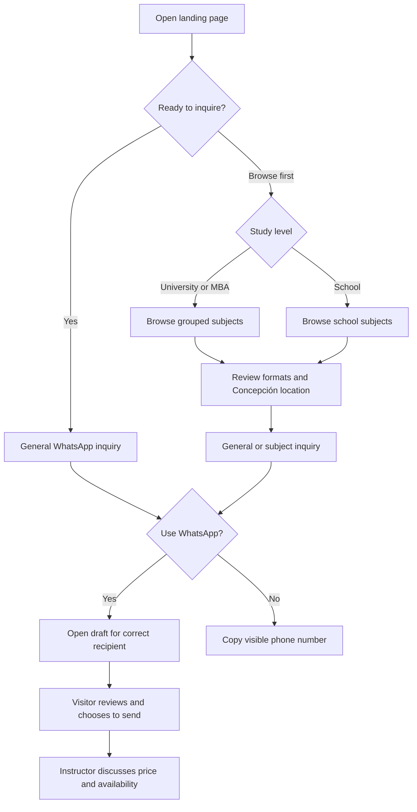
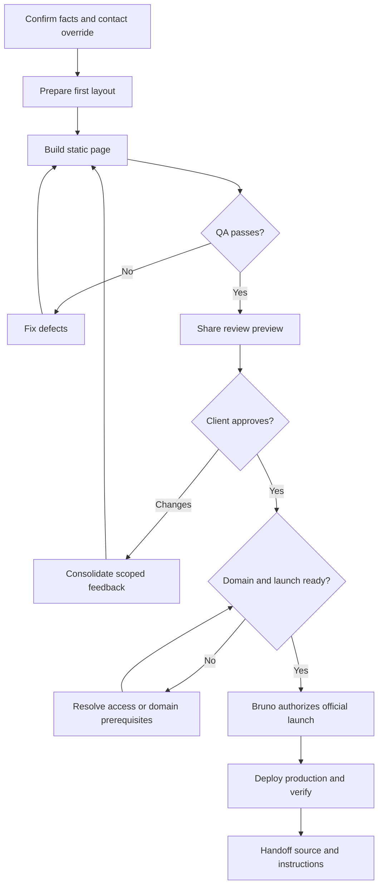

# Flowcharts

Two diagrams are sufficient: one shows the visitor's choices and WhatsApp handoff; the other shows development, revision and launch gates. No database/entity diagram is needed for a static page without stored application data.

View the SVG copies directly in a browser. The Mermaid sources below remain editable and describe the same flows.

## Visitor journey

WhatsApp runs outside the landing page. A click is not a sent message or a reservation. Visitors can also choose not to contact the instructor; no data is submitted by simply reading the page. The copy-number path allows later manual contact.

## Delivery workflow

Client feedback outside the agreed scope requires re-estimation. Domain/access readiness can be worked on while the first version is being built. This workflow is a plan, not evidence that any approval or deployment has already occurred.
